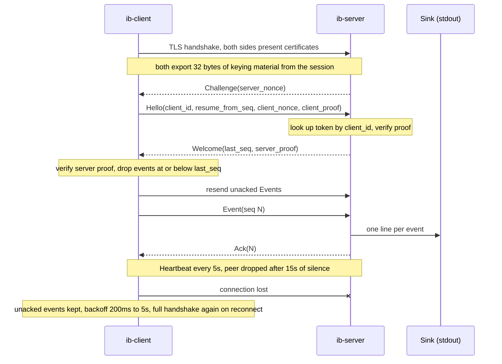

<div align="center">

# Reflex

**A small Rust client/server pair that captures input events and streams them over an untrusted network without losing any.**

[](#development)
[](#licence)
[](#limitations)

[Quick start](#quick-start) • [Security](#security-model) • [How it works](#how-it-works) • [Guarantees](#delivery-guarantees) • [Tuning](#tuning) • [Extending](#extending-reflex) • [Docs](#documentation)

</div>

---

Reflex has three binaries. `ib-client` captures events, buffers them with explicit backpressure and sends them over a mutually authenticated, resumable TLS link. `ib-server` accepts any number of clients, discards duplicates and writes one line per event to stdout, so it slots into an ordinary shell pipeline. `ib-certgen` mints the private CA, certificates and tokens the other two need.

The transport, security and reliability layers are the finished part. OS capture sits behind a single function so you can start with the portable stdin backend and swap in real keyboard and mouse hooks later without touching anything else.

## Quick start

Build everything:

```bash
cargo build --release
```

Mint credentials. This writes a CA, a server certificate valid for `localhost` and `127.0.0.1`, and a certificate plus token for each client you name:

```bash
./target/release/ib-certgen --out certs --client laptop-a
```

Start the server in one terminal and pipe its output wherever you want:

```bash
./target/release/ib-server 127.0.0.1:9001 \
  --cert certs/server.pem --key certs/server.key \
  --ca certs/ca.pem --tokens certs/tokens.txt | your-downstream-program
```

Run the client in another terminal. The demo backend reads stdin line by line:

```bash
echo "hello" | ./target/release/ib-client 127.0.0.1:9001 laptop-a \
  --cert certs/laptop-a.pem --key certs/laptop-a.key \
  --ca certs/ca.pem --token certs/laptop-a.token
```

The server prints one tab-separated line per event to stdout:

```text
laptop-a    1    1760918400123456    Text { data: "hello" }
```

| Column             | Meaning                                                  |
|--------------------|----------------------------------------------------------|
| `client_id`        | The id the client authenticated as                       |
| `seq`              | Monotonic, gap-free sequence number per client           |
| `timestamp_micros` | Microseconds since the Unix epoch, taken at capture time |
| `kind`             | The event payload, printed with Rust `Debug` formatting  |

Logs go to stderr on both sides. The server's stdout carries nothing but events.

### Deploying across machines

Give the server certificate every name or address clients will dial, and copy each client only its own files:

```bash
./target/release/ib-certgen --out certs --server-name 10.0.0.5 --server-name relay.example.internal \
  --client laptop-a --client laptop-b
```

| File                                             | Goes to                  | Secret              |
|--------------------------------------------------|--------------------------|---------------------|
| `ca.pem`                                         | server and every client  | no                  |
| `server.pem`, `server.key`, `tokens.txt`         | server only              | key and tokens, yes |
| `laptop-a.pem`, `laptop-a.key`, `laptop-a.token` | laptop-a only            | key and token, yes  |
| `ca.key`                                         | nowhere that runs Reflex | yes                 |

Keys and tokens are written with mode `0600`. The CA key is only needed to issue more certificates later. The `.gitignore` excludes all of them.

## Security model

Reflex assumes the network between client and server is hostile. Three layers stack on each other.

| Layer                       | What it gives you                                                                                                                                                                                                                                                                                | What it stops                                                                                                                                                                                                                               |
|-----------------------------|--------------------------------------------------------------------------------------------------------------------------------------------------------------------------------------------------------------------------------------------------------------------------------------------------|---------------------------------------------------------------------------------------------------------------------------------------------------------------------------------------------------------------------------------------------|
| **Mutual TLS** via `rustls` | Encryption, integrity, and a certificate check in both directions                                                                                                                                                                                                                                | Eavesdropping, tampering, and any peer without a certificate from your CA. They never get past the TLS handshake.                                                                                                                           |
| **Token handshake**         | Each client has its own token. The server challenges, the client proves it holds the token for the id it claims, then the server proves it holds the same token. Both proofs are HMAC-SHA256 over the two nonces, the client id, and 32 bytes of keying material exported from this TLS session. | A client with a valid certificate claiming someone else's id. A stolen certificate without the token, or a stolen token without the certificate. Replaying a captured handshake on another connection, because the keying material differs. |
| **Application checks**      | Sequence numbers must land within `MAX_SEQ_AHEAD` of what the server has delivered. Frames and messages are capped at 1 MiB. Handshakes time out. Idle registry entries are evicted.                                                                                                             | A client poisoning its own dedup state so later genuine events are discarded. Oversized allocations. Half-open connections and unbounded memory from many ids.                                                                              |

Authentication failures on the client are fatal, exit code 2. Only network failures are retried.

### Trust model

**The client always initiates.** The server binds a port and waits. It never dials out and does not know where clients live. Clients can sit behind NAT or change address freely; they need only outbound access to the server. Once connected, the server sends the first application frame, the `Challenge`, so the client cannot precompute or replay its proof.

**The CA is yours and private.** `ib-certgen` creates a single key pair. The public half, `ca.pem`, is the one thing every participant trusts. The private half, `ca.key`, signs each certificate once and should then live offline. No public CA, system trust store, internet lookup, OCSP or CRL is involved. A certificate from any other issuer is rejected, and the chain is one step long.

**Credentials are the identity.** The server accepts a client if, and only if, it presents a certificate signed by `ca.pem`, proves it holds the matching private key, and proves it holds the token on file for the id it claims. The server does not check the client's IP address, hostname, user account or anything else about the machine. Whoever holds a client's `.key` and `.token` files is that client, exactly as whoever holds an SSH private key is that user.

**What a rogue client can do.**

| Rogue holds                                        | Outcome                                                                          |
|----------------------------------------------------|----------------------------------------------------------------------------------|
| The `ib-client` binary only                        | Refused at the TLS handshake. The binary contains no secrets.                    |
| A certificate it signed itself                     | Refused at the TLS handshake. It does not chain to `ca.pem`.                     |
| A stolen client certificate and key, no token      | Passes TLS, fails the token proof. Logged as `token proof failed`.               |
| A stolen certificate, key and token for `laptop-a` | Accepted as `laptop-a`. This is a stolen identity, and the protocol cannot tell. |
| `ca.key`                                           | Can mint a certificate for any id, but still needs that id's token.              |

The last two rows are why the defence against a compromised client host is operational, not cryptographic: keep `ca.key` off Reflex hosts, revoke a client by removing its line from `tokens.txt`, and consider the items under [Limitations](#limitations). IP allow-listing is deliberately not built in; put it in the firewall if your clients have fixed addresses.

### What each side validates, in order

Every check below is enforced in code. A failure at any step closes the connection before the next step runs, and no event is sent or accepted until all of them have passed.

**The client validates the server.**

| Step | Check                                                                                                                                                                                                                       | Where                            |
|------|-----------------------------------------------------------------------------------------------------------------------------------------------------------------------------------------------------------------------------|----------------------------------|
| 1    | Server certificate chains to the CA in `--ca`. Self-signed or foreign certificates fail here.                                                                                                                               | rustls, `with_root_certificates` |
| 2    | Server certificate is valid for the name being dialled, or for `--server-name` if given. A valid certificate for the wrong host fails here.                                                                                 | rustls server name verification  |
| 3    | TLS handshake completes within `HANDSHAKE_TIMEOUT`.                                                                                                                                                                         | client `run_session`             |
| 4    | First frame is a `Challenge` and its `protocol_version` matches.                                                                                                                                                            | client `run_session`             |
| 5    | The `Welcome` proof verifies against this client's token, both nonces, its own id and this session's keying material. This is the step that proves the server holds the client's token, not just a certificate from the CA. | `protocol::verify_server_proof`  |

Only after step 5 does the client trust `last_seq` from the `Welcome` and begin resending.

**The server validates the client's claim.**

| Step | Check                                                                                                                                                                                                                                                     | Where                           |
|------|-----------------------------------------------------------------------------------------------------------------------------------------------------------------------------------------------------------------------------------------------------------|---------------------------------|
| 1    | Client presents a certificate that chains to the CA in `--ca`. No certificate, or one from another CA, fails here.                                                                                                                                        | rustls, `WebPkiClientVerifier`  |
| 2    | TLS handshake completes within `HANDSHAKE_TIMEOUT`.                                                                                                                                                                                                       | server `handle_connection`      |
| 3    | First frame arrives within `HANDSHAKE_TIMEOUT` and is a `Hello`.                                                                                                                                                                                          | server `handle_connection`      |
| 4    | `protocol_version` matches and `client_id` is not blank.                                                                                                                                                                                                  | server `validate_hello`         |
| 5    | `client_id` exists in the token file. Unknown ids are rejected.                                                                                                                                                                                           | server `handle_connection`      |
| 6    | The `Hello` proof verifies against that id's token, both nonces, the claimed id and this session's keying material. Constant-time comparison. A valid certificate holder claiming another id fails here, because the proof was made with the wrong token. | `protocol::verify_client_proof` |

Only after step 6 is the id treated as authenticated, the registry entry touched, and the `Welcome` sent. The `resume_from_seq` field in `Hello` is informational: the server always answers with its own `last_seq` and the client defers to it.

**What keeps the session valid afterwards.**

- Every frame after the handshake travels inside the same TLS session, so injection, modification or truncation by anyone on the path fails the TLS record check and ends the connection.
- Heartbeats flow both ways every `HEARTBEAT`. A peer silent for `LIVENESS_TIMEOUT` is dropped, so a hijacked or dead link is noticed within seconds rather than trusted indefinitely.
- Each event's `seq` must be at most `MAX_SEQ_AHEAD` past what the server has delivered. Anything beyond that closes the connection without touching `last_seq`.
- Every frame is capped at `MAX_FRAME_BYTES` before it is decoded.
- Any message out of place closes the connection: a second `Hello`, a `Challenge` or `Welcome` sent by a client, an `Event` sent by the server.
- A reconnect is a brand-new TLS session with a fresh challenge. Nothing from a previous session, including its proofs, is accepted again.

**Identity comes from files, not from the process.** Neither binary reads the user it runs as, and the only environment variable consulted is `HOSTNAME` (or `COMPUTERNAME` on Windows), used solely to build a default client id when none is given on the command line. Nothing from the environment crosses the wire.

**What this is not.** The server trusts an authenticated client's event payloads and timestamps. It has no rate limiting beyond bounded buffers, and it does not stop two sessions using the same client certificate at once. See [Limitations](#limitations).

## How it works



### Client pipeline

1. **Capture task** runs once for the life of the process, independent of the network. It pushes `Captured` values into a ring buffer.
2. **Event ring** is a bounded `VecDeque` with a drop-oldest policy and a dropped counter. A fast input source can never exhaust memory or stall the OS hook.
3. **Outbound state** assigns each event a sequence number and holds it in an unacked buffer until the server confirms it. This state survives reconnects.
4. **Session loop** connects over TLS, completes the token handshake, resends every unacked event, then pumps new events and acks until the link fails or all work is done.

### Server pipeline

1. **Accept loop** spawns one task per connection and evicts idle registry entries. A slow or misbehaving client cannot stall the others.
2. **TLS accept** rejects any peer without a certificate from the configured CA, within a handshake timeout.
3. **Token handshake** looks the token up by the claimed id, verifies the client's proof, and replies with the server's own proof plus the highest sequence already delivered for that id.
4. **Per-client registry** remembers `last_seq` for every client id, so a reconnecting client resumes without replaying work.
5. **Sink** receives each new event exactly once. The registry lock is released before the sink is called, so a slow sink never blocks other connections.

## Delivery guarantees

| Failure                                 | What Reflex does                                                                                 |
|-----------------------------------------|--------------------------------------------------------------------------------------------------|
| Short or partial TCP read               | Length-delimited framing. A message is never split or merged.                                    |
| Connection drops mid-stream             | Unacked events stay buffered and are resent after the next handshake. Nothing in flight is lost. |
| Same event arrives twice                | Server dedups by sequence number and re-acks without touching the sink.                          |
| Server is down for a while              | Client reconnects with exponential backoff, 200 ms doubling to a 5 s cap.                        |
| Peer dies silently                      | Heartbeats every 5 s in both directions. A peer silent for 15 s is dropped.                      |
| Input faster than the network           | Ring drops the oldest event and increments a counter rather than blocking capture.               |
| Server unreachable for a while          | Events wait in the ring. Past 4,096 the oldest is dropped and counted. Sequenced events are kept. |
| Server connected but not acknowledging  | Unacked buffer sheds its oldest entry past 65,536 events and counts the shed.                    |
| Input source closes                     | Client sends `Bye` and exits only once every event has been acknowledged.                        |
| Client sends a sequence far ahead       | Connection dropped, `last_seq` untouched, genuine events still flow afterwards.                  |

Delivery is at-least-once on the wire and exactly-once at the sink, with in-order processing per client. The two counters (`dropped` at capture, `shed` in the unacked buffer) are the only places an event can be lost, and both are reported on stderr at every reconnect.

## Wire protocol

Messages are `bincode`-serialised Rust enums carried inside length-delimited frames over TLS. The `protocol` crate is shared by both binaries so the two ends cannot drift apart, and it enforces the 1 MiB limit on both encode and decode. `PROTOCOL_VERSION` is currently `2`.

| Message                                                                | Direction        | Purpose                                                                                     |
|------------------------------------------------------------------------|------------------|---------------------------------------------------------------------------------------------|
| `Challenge { protocol_version, nonce }`                                | server to client | First frame after TLS. Fresh nonce per connection.                                          |
| `Hello { client_id, protocol_version, resume_from_seq, nonce, proof }` | client to server | Claims an id and proves possession of its token, bound to this TLS session.                 |
| `Welcome { last_seq, proof }`                                          | server to client | Accepts the client, proves the server holds the same token, and says where delivery got to. |
| `Event { seq, timestamp_micros, kind }`                                | client to server | One captured input event.                                                                   |
| `Ack { seq }`                                                          | server to client | Everything up to and including `seq` reached the sink. Cumulative and idempotent.           |
| `Heartbeat { seq }`                                                    | both             | Liveness probe on a fixed interval.                                                         |
| `Bye`                                                                  | both             | Polite shutdown. The peer may close immediately.                                            |

`EventKind` carries the payload and is the only type you need to extend when adding a real capture backend:

```rust
pub enum EventKind {
    Key { code: u32, pressed: bool },
    Mouse { x: i32, y: i32, button: Option<u8>, pressed: bool },
    Text { data: String },
    Raw { bytes: Vec<u8> },
}
```

## Workspace layout

```text
protocol/   shared message types, HMAC proofs, encode and decode
server/     ib-server: mutual TLS, token check, dedup, acks, forwards to a sink
client/     ib-client: capture, bounded ring, mutual TLS, resumable link
certgen/    ib-certgen: mints the CA, certificates and tokens
e2e/        end-to-end tests that spawn the real binaries
```

## Tuning

Every knob is a `const` at the top of the relevant `main.rs`, except the frame cap which lives in `protocol`. Adjust them to your event rate and latency budget.

| Constant            | Default | Where          | Effect                                                                     |
|---------------------|---------|----------------|----------------------------------------------------------------------------|
| `HEARTBEAT`         | 5 s     | client, server | Interval between liveness probes                                           |
| `LIVENESS_TIMEOUT`  | 15 s    | client, server | Silence before a peer is dropped                                           |
| `HANDSHAKE_TIMEOUT` | 10 s    | client, server | Time allowed for TLS plus the token handshake                              |
| `MAX_FRAME_BYTES`   | 1 MiB   | protocol       | Largest frame or message either side will accept                           |
| `RING_CAPACITY`     | 4,096   | client         | Events held between capture and network before drop-oldest kicks in        |
| `MAX_UNACKED`       | 65,536  | client         | Events held awaiting acks before the oldest is shed                        |
| `MAX_SEQ_AHEAD`     | 65,536  | server         | How far past `last_seq` an event may land before the connection is dropped |
| `REGISTRY_TTL`      | 1 h     | server         | How long a disconnected client's state is remembered                       |
| `BACKOFF_START`     | 200 ms  | client         | First reconnect delay                                                      |
| `BACKOFF_MAX`       | 5 s     | client         | Reconnect delay ceiling                                                    |

## Extending Reflex

### Real OS input capture

Replace the body of `capture_task` in `client/src/main.rs`. Keep pushing `Captured` values into the same ring. Nothing downstream changes.

| Platform    | Capture            | Inject        | Notes                                                                                                                                         |
|-------------|--------------------|---------------|-----------------------------------------------------------------------------------------------------------------------------------------------|
| Linux (X11) | XInput2            | XTest         | Wayland blocks global capture. Fall back to evdev and uinput, which need root or the `input` group.                                           |
| macOS       | `CGEventTap`       | `CGEventPost` | Needs the Accessibility permission, plus Screen Recording for pixels. Check it at runtime because macOS silently drops events when it lapses. |
| Windows     | `SetWindowsHookEx` | `SendInput`   |                                                                                                                                               |

Cross-platform starting points: `rdev` or `device_query` for capture, `enigo` for injection. Expect to patch edge cases.

### A different sink

Implement `EventSink` in `server/src/main.rs` and swap `StdoutSink` for your type. The trait has one method, `handle(&self, client_id, &Event)`, and is called exactly once per new event.

### A different identity source

Tokens are looked up from a `client_id token` file at startup. To pull them from a secrets manager or rotate without a restart, replace `load_tokens` and the `Tokens` map in `server/src/main.rs`. The handshake code does not care where the bytes come from.

### Another language on one end
Replace the bodies of `encode` and `decode` in `protocol` with Protobuf or FlatBuffers, and port the two HMAC proof functions. Everything else is standard TLS and length-prefixed framing.

## Documentation

- [How to generate the TLS server credentials](doc/how-to-generate-tls-server.md): minting, checking, distributing, adding a client, rotating the server certificate, revoking, and a troubleshooting table.
- [CONTRIBUTING.md](CONTRIBUTING.md): building, testing, style, and what a change to the protocol or security model must include.
- [SECURITY.md](SECURITY.md): how to report a vulnerability and what is in scope.
- [CHANGELOG.md](CHANGELOG.md): notable changes per release.

## Development

```bash
cargo test              # unit tests plus end-to-end tests against the real binaries
cargo build --release
```

Run `cargo test` from the workspace root. The end-to-end tests spawn `ib-server`, `ib-client` and `ib-certgen` from the build directory, so all three must be built, which a workspace-wide test run does for you.

| Test                                                                | Covers                                                                |
|---------------------------------------------------------------------|-----------------------------------------------------------------------|
| `delivers_events_in_order_over_mutual_tls`                          | Happy path with the real binaries                                     |
| `refuses_a_peer_without_a_client_certificate`                       | TLS layer rejects anonymous peers                                     |
| `refuses_a_valid_certificate_with_the_wrong_token`                  | Token layer rejects a bad proof                                       |
| `refuses_a_certificate_holder_claiming_another_client_id`           | One client cannot impersonate another                                 |
| `rejects_a_sequence_far_ahead_and_keeps_serving_the_genuine_client` | Dedup state cannot be poisoned                                        |
| protocol unit tests                                                 | Round trips, proof verification, proofs fail on any change, frame cap |

The original dependency set in `Cargo.toml` is pinned with `=` and was verified on rustc 1.75. The TLS and token dependencies use caret ranges and the workspace is verified on current stable.

The release profile uses `opt-level = 3`, thin LTO, a single codegen unit and `panic = "abort"` for a small, predictable binary.

Before opening a pull request run `cargo fmt --all` and `cargo clippy --workspace --all-targets -- -D warnings`. CI runs both plus the test suite on Ubuntu and macOS. See [CONTRIBUTING.md](CONTRIBUTING.md).

## Limitations

- **Server state is in memory.** Restarting the server forgets every client's `last_seq`, so a client that reconnects afterwards will have its unacked buffer delivered again.
- **Authenticated clients are trusted about content.** Event payloads and timestamps are taken as given. If a client host is compromised, it can send whatever events it likes under its own id.
- **No rate limiting or connection cap.** A client with valid credentials can open many connections. Two sessions on the same credentials both deliver.
- **No certificate revocation.** To cut a client off, remove its line from the token file and restart the server, or reissue the CA.
- **Bounded buffers drop data by design.** Ring overflow and unacked-buffer shedding both lose events. Both are counted and logged, but neither is an error.
- **The stdin capture backend is a stand-in.** It demonstrates the pipeline and is not a keyboard or mouse hook.

## Licence

Dual-licensed under either of

- MIT ([LICENSE-MIT](LICENSE-MIT))
- Apache License, Version 2.0 ([LICENSE-APACHE](LICENSE-APACHE))

at your option.

---

<div align="center">

**Capture once, deliver once, lose nothing in between.**

[Quick start](#quick-start) • [Security model](#security-model) • [Limitations](#limitations)

</div>
